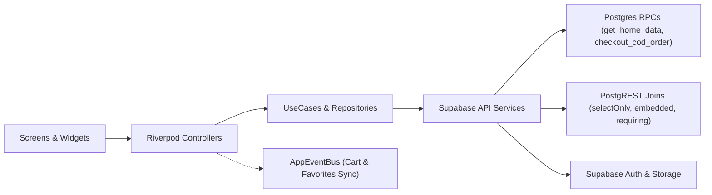

<div align="center">

# Storey App

**A modern Flutter e-commerce app powered by Supabase, Riverpod, and GoRouter.**

<p>
  
  
  
  
  
</p>

<p>
  <a href="#features">Features</a> •
  <a href="#how-it-works">How It Works</a> •
  <a href="#supabase--architecture">Supabase &amp; Architecture</a> •
  <a href="#project-structure">Structure</a> •
  <a href="#getting-started">Getting Started</a>
</p>

</div>

---

## Features

| Feature | What it includes |
| :--- | :--- |
| **Auth** | Email & password sign in/sign up with automatic session redirect |
| **Home** | Promo banners, categories, featured products, and popular items |
| **Catalog & Search** | Search by name or brand, filter by category/price, and sort results |
| **Product Details** | Pricing, discounts, ratings, wishlist toggle, and add-to-cart |
| **Favorites** | Saved items grid synced across all screens |
| **Cart & Checkout** | Quantity controls, clear cart, and one-tap Cash-on-Delivery checkout |
| **Orders & Details** | Order history, status filters, progress timeline, and item breakdown |
| **Profile** | Edit user details and upload profile photos to Supabase Storage |

---

## How It Works



---

## Supabase & Architecture

| Highlight | Where it is used | Why it helps |
| :--- | :--- | :--- |
| **Postgres RPCs** | `get_home_data`, `checkout_cod_order` | Runs multi-step home loads and atomic COD checkout in a single round-trip |
| **Inner Joins** | `.requiring(Cart.products)`, `.requiring(OrderedProduct.products)` | Automatically filters out unavailable or deleted products cleanly |
| **User-Scoped Embeds** | `.embedded(Products.favorites, ...)` | Loads wishlist state inside product, search, cart, and order queries with no extra calls |
| **Typed Schema** | `lib/core/network/supabase_schema.g.dart` | Generated via `supabase_typegen` so table columns and relations are checked at compile time |
| **Unified Errors** | `fastHandler` with `Either<Failure, T>` | Converts Auth, PostgREST, Storage, and network errors into clean UI messages |
| **Debug Network Logs** | `SupabaseLogger` (`kDebugMode` only) | Pretty-prints requests, responses, and timings while redacting `authorization` and `apikey` headers |

---

## Tech Stack

| Category | Packages |
| :--- | :--- |
| **Core** | `flutter`, `flutter_riverpod ^3.5.0`, `go_router ^18.1.3`, `dartz ^0.10.1` |
| **Supabase** | `supabase_flutter ^3.0.0-dev.16`, `supabase_typegen ^0.8.2`, `flutter_dotenv ^6.0.1` |
| **UI & Media** | `cached_network_image`, `carousel_slider`, `flutter_animate`, `flutter_svg`, `skeletonizer`, `pull_to_refresh`, `image_picker` |

---

## Project Structure

<details>
<summary><strong>Click to expand workspace layout</strong></summary>

```text
lib/
├── main.dart                         # Loads .env, initializes Supabase & DI, attaches SupabaseLogger
├── core/
│   ├── app/                          # StoreyApp MaterialApp.router root
│   ├── config/env.dart               # Environment keys (SUPABASE_URL, SUPABASE_PUBLISHABLE_KEY)
│   ├── di/dependency_injection.dart  # Riverpod DI providers & extensions
│   ├── enums/                        # ReqState, OrderStatus
│   ├── events/                       # AppEventBus & EventBusMixin
│   ├── extensions/                   # Supabase requireUserId, navigation & formatting helpers
│   ├── network/                      # error_handler, failure_message, SupabaseLogger, supabase_schema.g.dart
│   ├── routing/                      # GoRouter routes & reactive auth guard
│   ├── shared/                       # Shared favorite, profile & cart mutations + controllers
│   ├── theme/                        # ColorM, FontsM, SizeM, ThemeManager
│   └── widgets/                      # PrimaryButton, AppCachedImage, StateRender, CustomizedSmartRefresh
└── features/
    ├── auth/                         # Sign in & sign up
    ├── cart/                         # Cart list, clear cart & COD checkout
    ├── favorites/                    # Saved items grid
    ├── home/                         # Home feed (banners, categories, featured & popular)
    ├── main_layout/                  # Bottom navigation shell
    ├── order_details/                # Order timeline, product items & cost summary
    ├── orders/                       # Order history & status filter bar
    ├── product_details/              # Product detail screen
    ├── products/                     # Paginated product listings
    ├── profile/                      # Account menu tab
    ├── search/                       # Search & multi-filter sheet
    ├── splash/                       # Initial session check
    └── update_profile/               # Profile & avatar editor
```

</details>

---

## Getting Started

> [!IMPORTANT]
> Create a `.env` file in the root directory before launching the app.

```env
SUPABASE_URL=your_supabase_project_url
SUPABASE_PUBLISHABLE_KEY=your_supabase_publishable_key
```

```bash
# 1. Install dependencies
flutter pub get

# 2. Run the app
flutter run
```

<details>
<summary><strong>Regenerate Supabase Dart types</strong></summary>

```bash
npx supabase gen types --lang dart --project-id <your-project-ref> --schema public > lib/core/network/supabase_schema.g.dart
```

</details>
